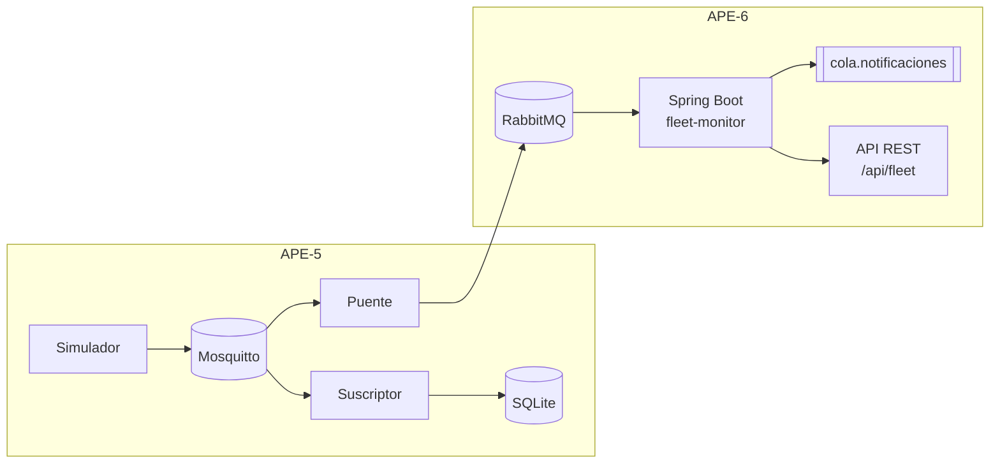
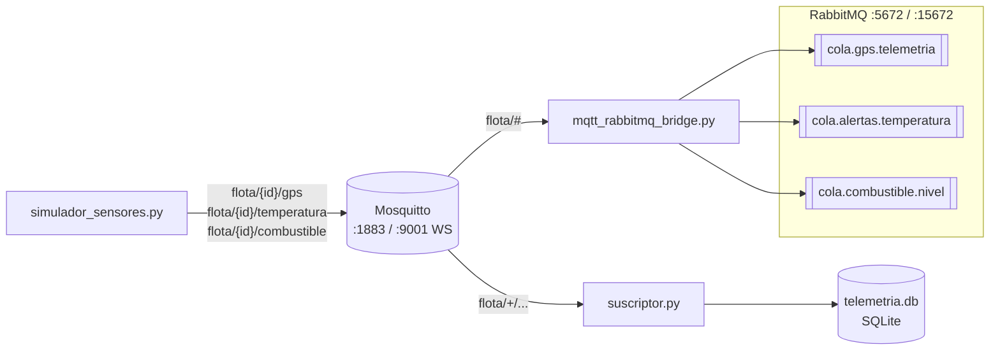
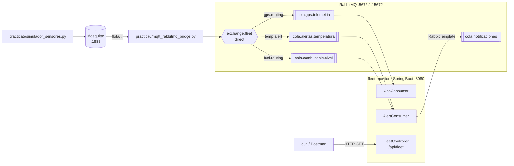

# APE-5 y APE-6 — Sistemas Distribuidos

**Mensajería distribuida con MQTT y RabbitMQ: monitoreo de una flota logística**

| Orden | Práctica | Tema | Carpeta |
|---|---|---|---|
| 1 | APE-5 (Parte 1) | MQTT con Mosquitto, simulador de sensores, almacenamiento en SQLite y puente MQTT → RabbitMQ | [`practica5/`](practica5) |
| 2 | APE-6 (Parte 2) | Microservicios Spring Boot con Spring AMQP que consumen las colas de RabbitMQ (actividades 5 a 8) | [`practica6/`](practica6) |

Las dos prácticas forman un solo sistema y se ejecutan en ese orden. Una empresa de
logística monitorea en tiempo real sus vehículos refrigerados: cada vehículo publica por
MQTT su posición GPS, la temperatura de la carga (cadena de frío) y el nivel de
combustible. **APE-5** construye la capa IoT: recoge la telemetría por MQTT, la guarda en
SQLite y reenvía a RabbitMQ lo que necesita procesamiento. **APE-6** reutiliza el broker
MQTT y el simulador de APE-5 y agrega la capa de microservicios: una aplicación Spring Boot
consume las colas, registra la telemetría GPS, redirige las alertas a una cola de
notificaciones centralizada y expone una API REST con el estado de la flota.



## Requisitos

- Docker con Docker Compose
- Python 3.10 o superior
- JDK 21 y Maven (Parte 2)
- Puertos libres: `1883`, `9001`, `5672`, `15672` y `8080`

## Preparación

Clona el repositorio y crea una sola vez el entorno virtual de Python en la raíz. Lo usan
las dos partes:

```bash
git clone https://github.com/Michu117/APE-6-Sistemas-Distribuidos.git
cd APE-6-Sistemas-Distribuidos
python -m venv .venv
source .venv/bin/activate          # Windows: .venv\Scripts\activate
pip install -r practica5/requirements.txt
```

Cada proceso se detiene con `Ctrl+C`.

---

# Parte 1 — APE-5: MQTT, SQLite y RabbitMQ

**Práctica 5: Mensajería distribuida con MQTT y RabbitMQ**

Sensores simulados publican telemetría por MQTT; un suscriptor la almacena en SQLite y
genera alertas, y un puente reenvía los datos relevantes a colas de RabbitMQ para que otros
servicios los consuman de forma asíncrona.

## Arquitectura



| Componente | Archivo | Función |
|---|---|---|
| Brokers | `practica5/docker-compose.yml` | Mosquitto 2.0 (MQTT 1883, WebSocket 9001) y RabbitMQ 3 con panel de administración |
| Simulador | `practica5/simulador_sensores.py` | Publica GPS, temperatura y combustible de 3 vehículos cada 5 s |
| Suscriptor | `practica5/suscriptor.py` | Guarda la telemetría en SQLite y muestra alertas por consola |
| Puente | `practica5/mqtt_rabbitmq_bridge.py` | Reenvía GPS y alertas desde MQTT a colas durables de RabbitMQ |

### Reglas de negocio

| Sensor | Condición | Acción del suscriptor | Cola en RabbitMQ |
|---|---|---|---|
| GPS | Siempre | Guarda en `gps_data` | `cola.gps.telemetria` |
| Temperatura | > 4 °C | Guarda en `temp_data` y alerta | `cola.alertas.temperatura` (`type: TEMP_ALERT`) |
| Combustible | < 20 % | Guarda en `fuel_data` y alerta | `cola.combustible.nivel` (`type: FUEL_LOW`) |

## Ejecución

Levanta los brokers desde `practica5/`:

```bash
cd practica5
docker compose up -d               # Mosquitto + RabbitMQ (guest/guest)
```

Luego, en **tres terminales** distintas, desde `practica5/` y con el entorno virtual activado:

```bash
python suscriptor.py              # Terminal 1: almacena y alerta
python mqtt_rabbitmq_bridge.py    # Terminal 2: reenvía a RabbitMQ
python simulador_sensores.py      # Terminal 3: genera la telemetría
```

Al terminar, detén los tres scripts. Si vas a continuar con la Parte 2, no hace falta apagar
los brokers ahora: el primer paso de la Parte 2 lo hace. Para apagarlos sin continuar:

```bash
docker compose down
```

### Verificación

- **MQTT:** `docker exec -it mosquitto_broker mosquitto_sub -t 'flota/#' -v`
- **SQLite:**
  ```bash
  python -c "import sqlite3; c=sqlite3.connect('telemetria.db'); [print(r) for r in c.execute('SELECT * FROM temp_data ORDER BY id DESC LIMIT 5')]"
  ```
- **RabbitMQ:** abrir <http://localhost:15672> (usuario `guest`, clave `guest`) y revisar la pestaña *Queues and Streams*.

> Si al levantar los contenedores aparece `Bind for 0.0.0.0:5672 failed: port is already allocated`,
> otro RabbitMQ está usando ese puerto. Detenlo (`docker stop <contenedor>`) y vuelve a ejecutar
> `docker compose up -d --force-recreate rabbitmq`.

## Capturas

### Actividad 1 — Mosquitto en Docker

Contenedores activos y configuración con el listener WebSocket en el puerto 9001:


Prueba de publicación y suscripción dentro del broker:


Topics jerárquicos de los 3 vehículos recibidos por un suscriptor MQTT (`flota/#`):


### Actividad 2 — Simulador de sensores


### Actividad 3 — Suscriptor y SQLite

Alertas por consola cuando la temperatura supera 4 °C:


Alertas de temperatura (> 4 °C) y de combustible bajo (< 20 %) en la consola del suscriptor:


Últimas filas almacenadas en cada tabla:


### Actividad 4 — Puente MQTT → RabbitMQ

Puente reenviando GPS y alertas `TEMP_ALERT` / `FUEL_LOW`:


Colas durables (`D`) con mensajes en el panel de RabbitMQ:


## Decisiones de diseño

- **Suscripción en `on_connect`:** si el cliente pierde la conexión con Mosquitto y se
  reconecta, las suscripciones se renuevan automáticamente; suscribirse una sola vez
  después de `connect()` las perdería.
- **Colas durables y mensajes persistentes (`delivery_mode=2`):** las colas y los
  mensajes sobreviven a un reinicio de RabbitMQ, así no se pierden alertas.
- **Heartbeats de pika:** `BlockingConnection` no es thread-safe, así que los callbacks de
  paho (que corren en otro hilo) solo encolan los mensajes en una `queue.Queue`. El hilo
  principal es el único que usa pika: publica lo pendiente y llama a
  `process_data_events()` en cada vuelta, lo que responde los heartbeats aunque no lleguen
  alertas y evita que RabbitMQ cierre la conexión por inactividad.
- **Consultas parametrizadas (`?`)** en SQLite para evitar inyección SQL, y manejo de JSON
  inválido o incompleto sin detener el suscriptor.

## Preguntas de control

**1. ¿Diferencias clave entre MQTT y AMQP? ¿Por qué MQTT es más adecuado para IoT?**

| | MQTT | AMQP (RabbitMQ) |
|---|---|---|
| Protocolo | Binario muy ligero, cabecera mínima de 2 bytes, sobre TCP | Más completo y pesado: canales, transacciones, confirmaciones, propiedades por mensaje |
| Patrón | Publicación/suscripción por topics a través de un broker | Colas con enrutamiento flexible (directo, fanout, topic, headers), punto a punto y pub/sub |
| Casos típicos | Sensores, dispositivos con poca batería, CPU o ancho de banda; redes inestables | Integración entre servicios backend, colas de trabajo, procesamiento confiable de tareas |

MQTT es más adecuado para IoT porque consume poco ancho de banda y energía, tolera
conexiones intermitentes (keepalive, sesiones persistentes, *last will*) y los dispositivos
solo necesitan conocer el broker y el topic. En esta práctica se combinan los dos: MQTT
recoge la telemetría de los vehículos y AMQP distribuye a los servicios internos solo lo
que requiere procesamiento.

**2. ¿Por qué MQTT usa jerarquías de topics y RabbitMQ usa exchanges, colas y bindings? ¿Ventajas de cada enfoque?**

- **Topics jerárquicos (MQTT):** el enrutamiento está implícito en el nombre
  (`flota/VH-001/temperatura`) y los suscriptores filtran con comodines (`+` un nivel,
  `#` varios niveles). Es simple, no requiere configuración previa y escala bien con miles
  de dispositivos. Su limitación es que el broker no almacena mensajes para consumidores
  ausentes salvo sesiones persistentes o mensajes *retained*.
- **Exchanges, colas y bindings (RabbitMQ):** separa quién publica (exchange) de dónde se
  guarda (cola) y cómo se conectan (binding). Permite reglas de enrutamiento complejas,
  repartir trabajo entre varios consumidores, persistir mensajes y confirmar su
  procesamiento (*ack*). A cambio, exige declarar y configurar esa topología.

En el proyecto, los topics de MQTT agrupan la telemetría por vehículo y sensor, y el puente
la traduce a colas durables específicas por tipo de alerta.

**3. Niveles de QoS en MQTT: ventajas, desventajas y uso en el monitoreo de flota**

| QoS | Garantía | Ventajas | Desventajas | Uso en la flota |
|---|---|---|---|---|
| 0 — *at most once* | Se envía una vez, sin confirmación | Máximo rendimiento, mínimo tráfico | Puede perderse | GPS: se publica cada pocos segundos y una lectura perdida se reemplaza con la siguiente |
| 1 — *at least once* | Se reenvía hasta recibir `PUBACK` | Garantiza la entrega con poco costo extra | Puede llegar duplicado | Temperatura y combustible: una alerta no debe perderse y un duplicado es inofensivo |
| 2 — *exactly once* | Handshake de 4 pasos (`PUBREC`/`PUBREL`/`PUBCOMP`) | Ni pérdidas ni duplicados | Mayor latencia y tráfico | Eventos que no se pueden repetir, como una orden remota de bloqueo del vehículo o un registro de facturación |

En la implementación actual el simulador publica con QoS 0 (valor por defecto) y el
suscriptor y el puente se suscriben con QoS 1; como el QoS efectivo es el menor de ambos,
para garantizar las alertas habría que publicar temperatura y combustible con `qos=1`.

---

# Parte 2 — APE-6: Microservicios con RabbitMQ y Spring Boot

**Práctica 6: Mensajería distribuida con RabbitMQ y MQTT. Parte 2: microservicios con
RabbitMQ y Spring Boot (actividades 5 a 8)**

Esta parte continúa la Parte 1. Reutiliza Mosquitto y el simulador de APE-5, levanta un
RabbitMQ propio con el usuario `admin` y agrega una aplicación Spring Boot que consume las
colas: registra la telemetría GPS, reenvía las alertas de temperatura y combustible a
`cola.notificaciones` y expone una API REST para consultar el estado de la flota.

## Arquitectura



A diferencia del puente de APE-5, que publica directamente en las colas a través del
exchange por defecto, el puente de APE-6 publica en `exchange.fleet` con las routing keys
que define `RabbitMQConfig`.

| Sensor | Cola (routing key) | Consumidor | Acción |
|---|---|---|---|
| GPS | `cola.gps.telemetria` (`gps.routing`) | `GpsConsumer` | Registra `GPS recibido` |
| Temperatura > 4 °C | `cola.alertas.temperatura` (`temp.alert`) | `AlertConsumer` | Registra `ALERTA TEMPERATURA` y reenvía a `cola.notificaciones` |
| Combustible < 20 % | `cola.combustible.nivel` (`fuel.routing`) | `AlertConsumer` | Registra `ALERTA COMBUSTIBLE` y reenvía a `cola.notificaciones` |

| Endpoint | Respuesta |
|---|---|
| `GET /api/fleet/status` | Resumen de la flota: `totalVehicles`, `activeAlerts` y `timestamp` |
| `GET /api/fleet/vehicle/{id}/telemetria` | Lista con la telemetría del vehículo indicado |

## Archivos por actividad

| Actividad | Archivos | Contenido |
|---|---|---|
| Configuración del entorno | `practica6/docker-compose-rabbitmq.yml` | RabbitMQ separado de Mosquitto, usuario `admin` / clave `admin123` |
| 5 — Proyecto Spring Boot | `fleet-monitor/pom.xml`, `FleetMonitorApplication.java`, `config/RabbitMQConfig.java`, `application.properties` | Dependencias AMQP, Web, JPA y H2; exchange directo `exchange.fleet`, 4 colas durables y 3 bindings |
| 6 — Servicio de telemetría GPS | `model/GpsMessage.java`, `consumer/GpsConsumer.java` | Modelo del mensaje GPS y consumidor de `cola.gps.telemetria` |
| 7 — Servicio de alertas | `consumer/AlertConsumer.java` | Consume las colas de temperatura y combustible y reenvía cada alerta a `cola.notificaciones` |
| 8 — API REST de consulta | `controller/FleetController.java` | Endpoints `/api/fleet/status` y `/api/fleet/vehicle/{id}/telemetria` |
| Puente | `practica6/mqtt_rabbitmq_bridge.py` | Copia del puente de APE-5 que publica en `exchange.fleet` |

Las clases Java están en `practica6/fleet-monitor/src/main/java/com/fleet/monitor/`.

## Ejecución

Los dos compose usan el nombre de contenedor `rabbitmq_broker`, así que primero se apaga el
RabbitMQ de la Parte 1 y se deja solo Mosquitto. Ejecuta cada paso en una terminal distinta,
en este orden y desde la raíz del repositorio:

```bash
# Terminal 1: brokers
cd practica5 && docker compose down && docker compose up -d mosquitto
cd ../practica6 && docker compose -f docker-compose-rabbitmq.yml up -d
```

Espera unos segundos a que RabbitMQ termine de iniciar.

```bash
# Terminal 2: microservicios (esperar "Started FleetMonitorApplication")
cd practica6/fleet-monitor
JAVA_HOME=/ruta/al/jdk-21 mvn spring-boot:run
```

`JAVA_HOME` solo hace falta si el `java` por defecto no es la versión 21.

```bash
# Terminal 3: puente, con el entorno virtual activado
python practica6/mqtt_rabbitmq_bridge.py

# Terminal 4: simulador, con el entorno virtual activado
python practica5/simulador_sensores.py

# Terminal 5: API REST
curl http://localhost:8080/api/fleet/status
curl http://localhost:8080/api/fleet/vehicle/VH-001/telemetria
```

Para apagar todo al terminar:

```bash
cd practica6 && docker compose -f docker-compose-rabbitmq.yml down
cd ../practica5 && docker compose down
```

### Verificación

- **Spring Boot:** la consola muestra `GPS recibido`, `ALERTA TEMPERATURA` y `ALERTA COMBUSTIBLE`.
- **RabbitMQ:** abrir <http://localhost:15672> (usuario `admin`, clave `admin123`).
  - En *Exchanges → exchange.fleet* aparecen 3 bindings.
  - En *Queues and Streams*, `cola.notificaciones` acumula mensajes porque no tiene
    consumidor, y las otras tres colas se mantienen cerca de 0 porque Spring Boot las consume.
- **API REST:** los dos `curl` responden con código 200 y JSON. También se pueden probar con
  Postman o abriendo las URL en el navegador.
- **Colas desde la terminal:**
  ```bash
  curl -s -u admin:admin123 http://localhost:15672/api/queues | python -m json.tool | grep -E '"name"|"messages"'
  ```

> Si el puente o Spring Boot fallan con `ACCESS_REFUSED`, sigue activo el RabbitMQ de la
> Parte 1 (`guest`) en lugar del de la Parte 2 (`admin`). Apágalo con `docker compose down`
> en `practica5/` y vuelve a levantar el de `practica6/`.

## Capturas

Las capturas están en el orden de ejecución. Las de consola se generaron a partir de la
salida real de cada terminal durante la prueba; las del panel de RabbitMQ son capturas del
navegador.

### Configuración del entorno

Mosquitto (de APE-5) y el RabbitMQ de APE-6 en ejecución:


### Actividad 5 — Proyecto Spring Boot

`fleet-monitor` iniciado y conectado a RabbitMQ con el usuario `admin`:


`exchange.fleet` (directo y durable) con sus 3 bindings:


### Flujo de entrada: simulador y puente

Simulador de APE-5 publicando la telemetría:


Puente publicando en `exchange.fleet` con la routing key de cada cola:


### Actividad 6 — Servicio de telemetría GPS

`GpsConsumer` recibiendo la telemetría de los 3 vehículos:


### Actividad 7 — Servicio de alertas

`AlertConsumer` registrando alertas de temperatura y combustible:


Las colas consumidas se mantienen en 0 y `cola.notificaciones` acumula las alertas reenviadas:


Contenido de `cola.notificaciones` (`content_type: text/plain`, mensajes persistentes):


### Actividad 8 — API REST de consulta

Respuestas de `FleetController` con `curl`:


## Diferencias con el código de la guía

| Cambio | Motivo |
|---|---|
| JDK 21 en lugar de 17 | Versión instalada y usada en el equipo; Spring Boot 3.5 es compatible con ambas |
| `@JsonProperty("vehicle_id")` en `vehicleId` de `GpsMessage` | El simulador de APE-5 envía el campo como `vehicle_id` |
| `GpsConsumer` solo registra el mensaje | El código de la guía deja el almacenamiento como comentario (`// Almacenar en base de datos`) |
| `FleetController` devuelve valores fijos | Es el código de la guía: `totalVehicles` y `activeAlerts` no se calculan a partir de los mensajes |
| Puente copiado en `practica6/` con credenciales `admin` / `admin123` | El RabbitMQ de APE-6 crea ese usuario en lugar de `guest` |
| El puente publica en `exchange.fleet` con `gps.routing`, `temp.alert` y `fuel.routing` | Usar los bindings definidos en `RabbitMQConfig` en lugar del exchange por defecto |
| El puente también declara el exchange directo durable y los bindings al conectar | Si el puente arranca antes que Spring Boot, el exchange ya existe y los mensajes no se pierden |
| `content_type` del puente cambiado a `text/plain` | Los consumidores reciben `String`. Con `application/json`, el convertidor de Spring intentaría deserializar el mensaje a otro tipo |

---

# Estructura del repositorio

```
practica5/                          # Parte 1 — APE-5
├── Capturas/                       # Evidencias de cada actividad
├── mosquitto/config/
│   └── mosquitto.conf              # Listeners 1883 (MQTT) y 9001 (WebSocket)
├── docker-compose.yml              # Mosquitto + RabbitMQ
├── simulador_sensores.py
├── suscriptor.py
├── mqtt_rabbitmq_bridge.py
├── requirements.txt                # paho-mqtt 2.x, pika
└── README.md
practica6/                          # Parte 2 — APE-6
├── capturas/                       # Evidencias de las actividades 5 a 8
├── docker-compose-rabbitmq.yml     # RabbitMQ con usuario admin
├── mqtt_rabbitmq_bridge.py         # Puente hacia exchange.fleet
└── fleet-monitor/                  # Proyecto Spring Boot (Maven)
    ├── pom.xml
    └── src/main/
        ├── resources/application.properties
        └── java/com/fleet/monitor/
            ├── FleetMonitorApplication.java
            ├── config/RabbitMQConfig.java
            ├── model/GpsMessage.java
            ├── consumer/
            │   ├── GpsConsumer.java
            │   └── AlertConsumer.java
            └── controller/FleetController.java
```
